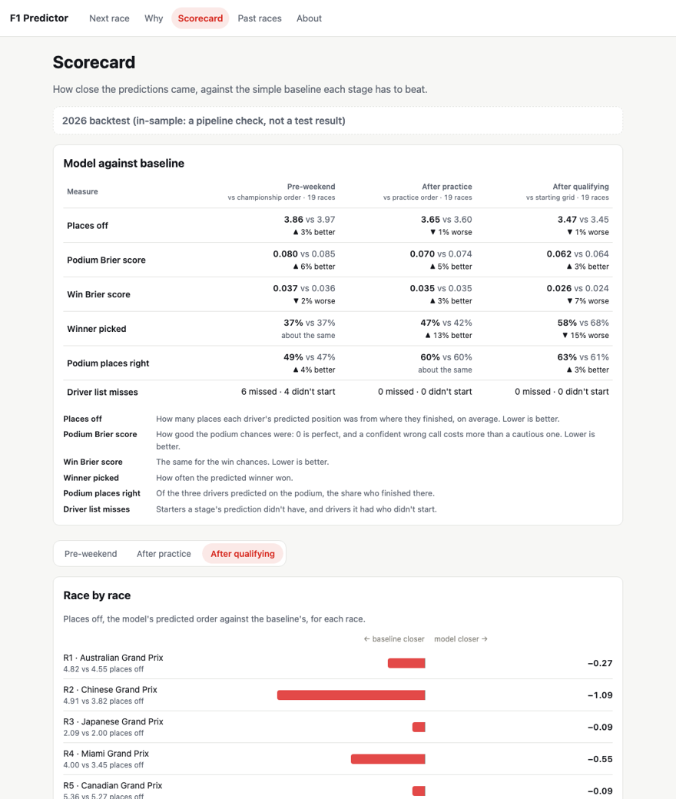
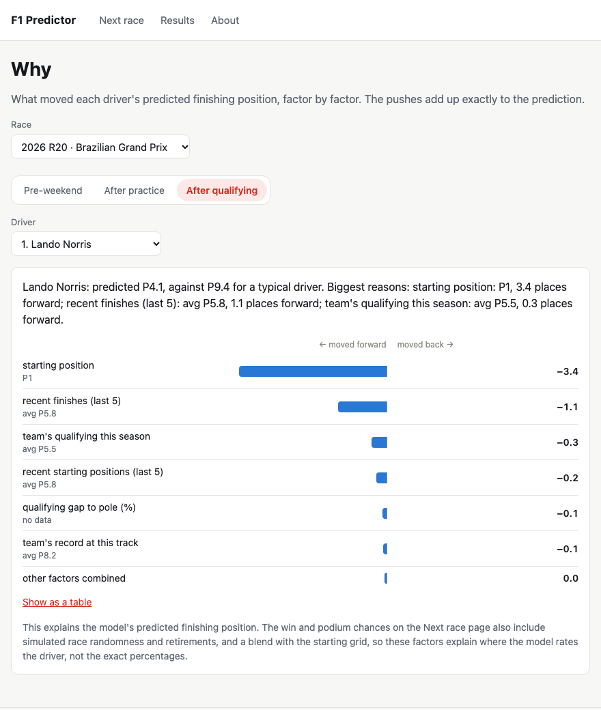
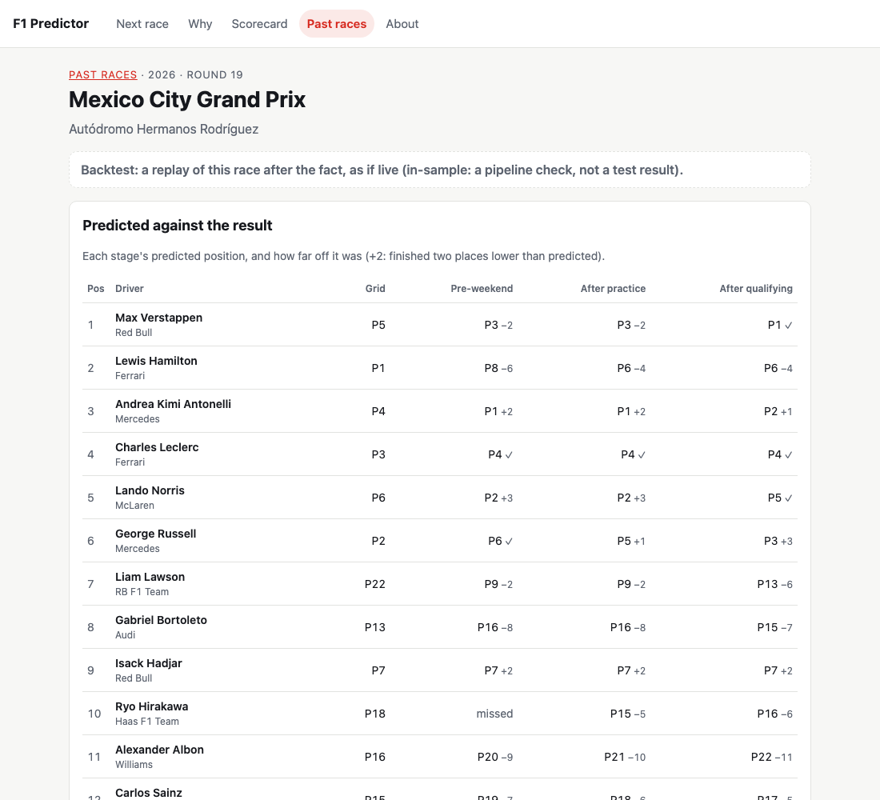

# F1 Race Prediction Platform

A self-updating F1 prediction system: one model for every Grand Prix, refreshed after each session, with a public scorecard of its own accuracy. See [docs/PRD.md](docs/PRD.md) for the full spec.

**Status:** all six phases are built. The pipeline predicts every race on its own (hourly on GitHub Actions), logs each prediction before its cutoff in a log the database won't let anyone edit, scores it after the race, and publishes everything to a public dashboard. 2026 rounds 20–23 are predicted live as a rehearsal (their own scorecard); the 2027 season, predicted live with frozen settings, is the real test ([docs/evaluation-protocol.md](docs/evaluation-protocol.md)).

**Dashboard:** [crystalge07.github.io/F1_Predictor](https://crystalge07.github.io/F1_Predictor/)

| Page | What it shows |
| --- | --- |
| Next race | The latest live prediction: predicted order, win / podium / points / retirement chances, and how the win chances moved from stage to stage |
| Why | The factors behind any driver's predicted position (SHAP), as a plain-English summary and a bar per factor |
| Scorecard | Model against each stage's baseline, race by race, and calibration; live, rehearsal and backtest results never mixed |
| Past races | Every logged prediction at each stage next to the real result |



<details>
<summary>More screenshots (Why, Past races)</summary>




</details>

The dashboard (`web/`, React + TypeScript) reads only static JSON files that the hourly pipeline exports from the database (`scripts/export_dashboard.py`) and deploys to GitHub Pages when anything changed; it has no server and can't touch the prediction log. See [web/README.md](web/README.md).

## How it works

The model predicts at three moments in a race weekend, each using only what is known at that moment:

| Stage | When | Uses |
| --- | --- | --- |
| Pre-weekend | before FP1 | recent form, team pace, track history, championship standings |
| Practice | after practice, before qualifying | the above + practice long-run and short-run pace |
| Post-quali | after qualifying | starting grid, gap to pole, form and team pace |

Each prediction goes through three pieces:

1. **Position model** (XGBoost, one per stage): where each driver finishes *if they finish*.
2. **DNF model**: each driver's chance of not finishing, from driver and team reliability, strongly pulled towards the field average (DNFs are mostly luck).
3. **Monte Carlo simulation**: 10,000 simulated races from (1) blended with a baseline order (the grid after qualifying), plus random swings and DNF draws, giving each driver's chance to win, podium and score points.

SHAP values explain each prediction ("starting position = 2: 3.8 places forward").

Every result below is **walk-forward**: the model for each race is trained only on earlier races.

## Results

Held-out races (2025 + 2026 rounds 10+, 34 races). Improvement in Brier score over each stage's baseline; positive = better.

| Stage | Baseline | Win | Podium |
| --- | --- | --- | --- |
| Pre-weekend | championship order | +7.7% | +2.7% |
| Practice | practice order | +5.7% | +16.1% |
| Post-quali | starting grid | −1.6% | +2.6% |

After qualifying, the starting grid is very hard to beat. Before qualifying, the models add clear value.

**2026 replay (Phase 4, in-sample).** All 19 races so far, each stage predicted as if live and logged before scoring. Better-than-baseline on the same information:

| Stage | Places off | Win Brier | Podium Brier |
| --- | --- | --- | --- |
| Pre-weekend | +2.8% | −1.9% | +5.6% |
| Practice | −1.3% | +2.6% | +5.1% |
| Post-quali | −0.6% | −6.7% | +2.8% |

Podium chances beat the baseline at every stage; win chances and finishing order are mixed. 2026 chose the settings and was looked at during development, so these numbers aren't a real test.

**Caveat:** these races were looked at many times during development, so the numbers are somewhat optimistic. The 2027 season, predicted live, is the real test. Details in [docs/evaluation-protocol.md](docs/evaluation-protocol.md).

## Data

[Jolpica-F1](https://github.com/jolpica/jolpica-f1) for calendar, results and qualifying (2018+); [OpenF1](https://openf1.org) for laps, stints, pit stops, weather, race control and the official starting grid (2023+). Stored in SQLite, in standard SQL so it can move to Postgres.

## Setup

Requires Python 3.10+.

```bash
python3 -m venv .venv            # create an isolated environment for this project
source .venv/bin/activate        # activate it (run this in every new terminal)
pip install -e ".[dev]" -c requirements.lock   # the project + dev tools, at the tested versions
pip install -e ".[dashboard]"    # optional: the Phase 2 Streamlit page (post-quali only; the real dashboard is web/)
brew install libomp              # macOS only: the OpenMP runtime XGBoost needs
```

`requirements.lock` pins every library to the version the tests pass on; the hourly pipeline installs from it, and a live prediction is refused if the model libraries (XGBoost, pandas, NumPy, scikit-learn, SciPy) differ from it. To upgrade: install the new versions, run the tests, then `python scripts/lock_requirements.py` and commit the lock.

## Usage

All commands run from the repo root with the virtual environment active.

**1. Build the database**

```bash
python scripts/init_db.py        # create the tables
python scripts/backfill.py       # download 2018-2026 (Jolpica + OpenF1; slow, resumable)
python scripts/validate.py       # audit the whole database and print a report (read-only)
```

**2. Evaluate**

| Script | What it shows |
| --- | --- |
| `evaluate_baseline.py` | the grid-order baseline, every season |
| `train_post_quali.py` | post-quali model vs the grid; saves the model to `data/models/` |
| `evaluate_pre_weekend.py` | pre-weekend model vs championship order |
| `evaluate_practice.py` | practice model vs practice order and the pre-weekend model |
| `evaluate_dnf.py` | DNF probabilities vs a flat rate |
| `evaluate_probabilities.py` | post-quali win/podium probabilities vs the grid |
| `evaluate_stage_probabilities.py` | pre-weekend and practice probabilities vs their baselines |

**3. Replay a season into the prediction log**

```bash
python scripts/replay_season.py                  # 2026, every race and stage (~2 minutes)
python scripts/replay_season.py --summary-only   # print the totals again
```

Deletes the season's earlier backtest runs first, so it can be re-run (live runs can never be deleted).

**4. Predict a race live (by hand)**

```bash
python scripts/predict_event.py 2026 20 pre_weekend          # dry run: prints the prediction and its checks, logs nothing
python scripts/predict_event.py 2026 20 pre_weekend --live   # logs it, only if it matches the dry run
```

Live runs can never be edited or deleted. 2026 rounds 20–23 are a live **rehearsal**, scored separately from the 2027 season (the real test).

**5. Run the pipeline once (what the scheduler does every hour)**

```bash
python scripts/tick.py --dry-run     # fetch data, predict and check, log nothing
python scripts/tick.py               # the real thing: may log live runs; exits 1 on a new alert
```

**6. Explain a prediction**

```bash
python scripts/explain_race.py 2026 19                   # post-quali stage
python scripts/explain_race.py 2026 19 --stage practice
```

**7. Look at the results in a browser**

```bash
streamlit run app/dashboard.py
```

## Automation

`.github/workflows/tick.yml` runs `scripts/tick.py` every hour. The database lives as `f1.sqlite.gz` on the GitHub Release named `database`. Each run downloads it, ticks, checks it's safe to upload (`scripts/check_db_upload.py`: healthy file, every live prediction still there and unchanged) and uploads it back, keeping the previous version and a daily backup per weekday. A run fails, so GitHub emails, when the tick raises a new alert.

One-time setup:

```bash
gzip -c data/f1.sqlite > data/f1.sqlite.gz
gh release create database data/f1.sqlite.gz --prerelease --title "Pipeline database" \
  --notes "SQLite database used by the scheduled pipeline. Not a software release."
gh variable set PIPELINE_ENABLED --body true      # switch the schedule on
gh workflow run tick.yml -f dry_run=true          # first run: a dry run
```

**Once it's on, the Release copy is the only real database.** Don't run `tick.py` or `predict_event.py --live` locally (that would write live runs into a copy nobody else sees). To look at the latest data locally:

```bash
gh release download database --pattern f1.sqlite.gz --dir data --clobber && gunzip -f data/f1.sqlite.gz
```

To pause: `gh variable set PIPELINE_ENABLED --body false`.

## Tuned settings

Every value a script tunes (2026 weight, DNF shrinkage, simulator blend and noise) lives in [`src/f1predictor/tuned_settings.json`](src/f1predictor/tuned_settings.json). The scripts write it; the code and the dashboard read it.

The file is currently **frozen**: re-running a tuning script can't change a value. To re-tune on purpose, remove the `frozen` entry in the same commit and explain why.

## Tests

```bash
pytest
```

## Layout

```
src/f1predictor/
  config.py, settings.py     paths and constants; tuned settings (+ tuned_settings.json)
  db/                        schema (raw data + the append-only prediction log) and connection
  ingest/                    Jolpica and OpenF1 loaders, backfill
  validate/                  data checks
  features/                  the race feature table: form, practice pace, championship,
                             team lineages, which features each stage may use, and
                             as_of.py: prediction rows from only what was known at each stage
  models/                    baselines, the position model, DNF probabilities
  simulate/                  Monte Carlo simulator and race probabilities
  predict/                   predict one race at one stage and write it to the prediction log
  explain/                   SHAP contributions
  pipeline/                  the hands-off weekend pipeline: plan.py decides what's due now,
                             fetch.py fetches exactly that, tick.py runs one hourly pass
  evaluate/                  metrics, walk-forward evaluation, and the scorer for logged runs
scripts/                     command-line entry points (see Usage)
app/                         Streamlit results dashboard
tests/                       pytest tests
docs/                        PRD and evaluation protocol
data/                        local SQLite DB and saved models (gitignored, rebuildable)
```
