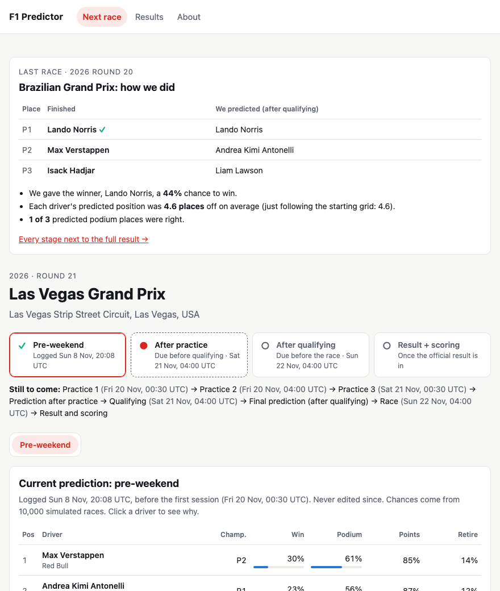
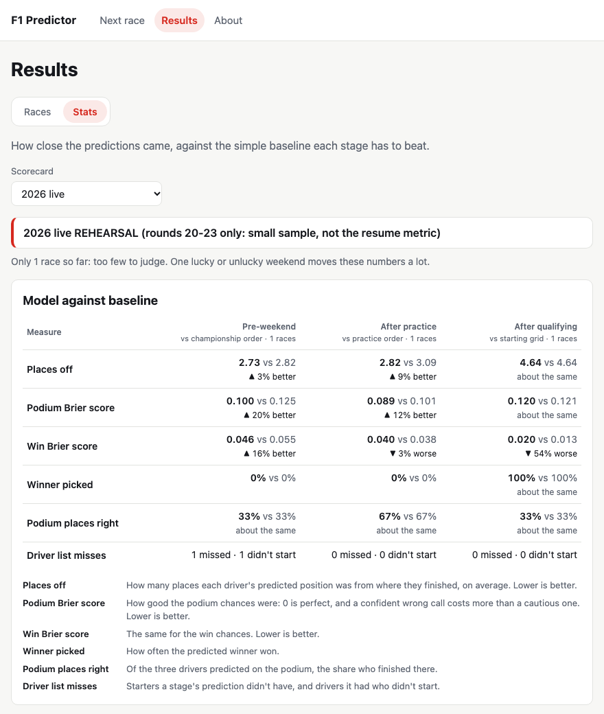

# 🏎️ F1 Race Prediction Platform

A self-updating Formula 1 prediction system. One machine-learning model covers every Grand Prix, re-predicts after each part of the race weekend, logs each prediction before the race so it can't be changed later, scores itself after the flag, and publishes everything to a public dashboard.

**📺 Live dashboard:** [crystalge07.github.io/F1_Predictor](https://crystalge07.github.io/F1_Predictor/)

**Status:** all six build phases are done and the pipeline runs on its own every hour. 2026 rounds 20–23 are predicted live as a **rehearsal**. The **2027 season**, predicted live with frozen settings, is the real test. Full spec: [docs/PRD.md](docs/PRD.md) · evaluation rules: [docs/evaluation-protocol.md](docs/evaluation-protocol.md).

---

## 🚀 Project Overview

Most F1 prediction projects are one script per race, rebuilt by hand each weekend. This one is a **system**:

- **One model for every circuit.** No per-race code. The same pipeline handles street tracks, sprint weekends, rookies, rebrands and cancelled sessions.
- **Three predictions per weekend.** Before the weekend, after practice and after qualifying. Each uses only what was known at that moment.
- **Probabilities as well as an order.** Every driver gets a chance to win, finish on the podium, score points and retire, from 10,000 simulated races.
- **Explainable.** Every prediction is broken down into the factors that moved it ("starting position 2: 3.8 places forward").
- **Honest scoring.** Predictions go into a log the database itself refuses to edit or delete. After the race each one is scored against a simple baseline that had the same information.
- **Hands-off.** A scheduled job runs every hour on GitHub Actions. It works out what's due (fetch a session, predict a stage, score a race), does it, and publishes the dashboard. Nobody has to touch it on a race weekend.

The model uses:

- Race results, qualifying and the calendar for every season from **2018** ([Jolpica-F1](https://github.com/jolpica/jolpica-f1))
- Lap-by-lap practice data, stints and the official starting grid from **2023** ([OpenF1](https://openf1.org))
- Engineered features: recent form, team pace, track history, championship standings, practice long-run and short-run pace, qualifying gap to pole
- **XGBoost** for finishing position, a **shrinkage model** for retirement risk, and a **Monte Carlo simulator** for probabilities

---

## 📊 Data Sources

| Source | What we pull | Seasons | Notes |
| --- | --- | --- | --- |
| [Jolpica-F1](https://github.com/jolpica/jolpica-f1) | Calendar (events, circuits, session times), race results, sprint results, qualifying (Q1/Q2/Q3 times), drivers, constructors | 2018+ | The free successor to the Ergast API. Can lag a few hours after a race. Limits: ~4 requests/s, 200/hour |
| [OpenF1](https://openf1.org) | Who drove each session (car number, acronym, team), every lap and sector time, tyre stints, pit stops, weather, race control messages, the official starting grid | 2023+ | Historical data is free. Data during a live session is paid, so we fetch after each session ends. Limits: 3 requests/s, 30/minute. Returns HTTP 404 for "no results" |
| [FastF1](https://github.com/theOehrly/Fast-F1) | Not used | — | Since Oct 2026, Formula 1's timing API needs a paid F1TV subscription |

**Coverage:** results and qualifying exist for every season since 2018. Lap-level data (and so the practice-pace features) only exists from 2023. Older rows leave those features empty, and the model learns to lean on history for them.

Everything is stored in one **SQLite** database (~35 MB), written in standard SQL so it could move to Postgres. Telemetry (throttle, brake, speed traces) isn't stored: no feature needs it.

---

## 🏁 How It Works

Here's the whole path from raw API data to a number on the dashboard:

```
 Jolpica (2018+)      OpenF1 (2023+)
       │                    │
       ▼                    ▼
 ┌─────────────────────────────────┐
 │ 1. Collect                      │  rate-limited HTTP client, retries with backoff
 │ 2. Clean, match & validate      │  one id per driver/team, UTC times, checks before saving
 └────────────────┬────────────────┘
                  ▼
           SQLite database
                  │
                  ▼
 ┌─────────────────────────────────┐
 │ 3. Feature table                │  one row per driver per race, history from earlier races only
 │ 4. "As-of" rows for this stage  │  who's racing + grid, from what existed at the cutoff
 └────────────────┬────────────────┘
                  ▼
 ┌─────────────────────────────────┐
 │ 5. Position model (XGBoost)     │  where each driver finishes, IF they finish
 │ 6. DNF model                    │  each driver's chance of retiring
 │ 7. Monte Carlo (10,000 races)   │  win / podium / points / retirement chances
 │ 8. SHAP explanations            │  which factors moved each prediction
 └────────────────┬────────────────┘
                  ▼
 ┌─────────────────────────────────┐
 │ 9. Prediction log (frozen)      │  written before the cutoff, never edited
 │10. Scorer                       │  after the race: model vs baseline
 └────────────────┬────────────────┘
                  ▼
 11. Hourly automation  ──►  12. JSON export  ──►  Dashboard (GitHub Pages)
```

### 1. Collecting the data (`ingest/`)

All API calls go through one small HTTP client (`ingest/http.py`) that does two things `requests.get()` alone doesn't:

- **Rate limiting.** It enforces a minimum gap between requests so we stay under each API's limits (Jolpica ~4/s, OpenF1 3/s) instead of getting blocked with HTTP 429.
- **Retries with backoff.** Timeouts and server errors (500, 503) are retried a few times, waiting longer each time, so a flaky network doesn't fail a whole run.

Each loader is split into three layers so the tricky part is easy to test:

1. **Fetch:** talk to the API. Jolpica pages its responses, so pages are merged. OpenF1 answers "no data" with a 404, which is turned into an empty list instead of an error.
2. **Parse:** pure functions that turn API JSON into our column values (no network, no database).
3. **Load:** write rows to SQLite with **upserts** (insert, or update if it's already there), so running a load twice never creates duplicates.

**From Jolpica**, per season: the schedule (`/{season}.json`: events, circuits, every session's date and time), race results, sprint results (2021+) and qualifying. Drivers and constructors arrive inside every result row, so they're upserted as we go.

**From OpenF1**, per session: `/drivers`, `/laps`, `/stints`, `/pit`, `/weather`, `/race_control`, and `/starting_grid` for qualifying sessions. OpenF1 has its own session ids (`session_key`), so each OpenF1 session is matched to the session Jolpica already created, by finding the event whose race falls on the same date and then the session type.

**The backfill** (`scripts/backfill.py`) runs this for 2018–2026. It's resumable: every item is recorded in an `ingestion_log` table (`ok` / `failed`), so a crash or rate-limit stop picks up where it left off.

### 2. Cleaning, matching and validating

Two APIs that describe the same weekend differently have to be lined up before anything is useful.

**One id per driver.** Jolpica's `driverId` (e.g. `max_verstappen`) is the canonical id. OpenF1 only knows car numbers and 3-letter acronyms, so every car in every session gets a row in `session_entries`, matched to a driver in this order (`ingest/openf1.match_entries`):

1. The same car number in this event's official result (exact)
2. A car OpenF1's driver list left out: the same car number's match from another session that weekend
3. The acronym among drivers who qualified at this event (for a debut driver before his first race result exists)
   - and if Jolpica gave that driver no code at all, his family name instead (accents and case ignored; only drivers who qualified here with no code, and only if exactly one fits)
4. The acronym's most recent race driver up to this season

A team is filled in from a matched teammate. A car that still can't be matched but is driving in the last session before qualifying is a race debutant with no Jolpica id yet: he's predicted under a temporary id (`provisional_2027_r1_car30`), and after the race the scorer swaps in his real id (`features/provisional.py`).

**One lineage per team.** Jolpica gives a team a new id whenever it rebrands. `features/teams.py` maps old ids to today's (Toro Rosso → AlphaTauri → RB, Renault → Alpine, Force India → Racing Point → Aston Martin, Sauber → Alfa Romeo → Audi), so features that span seasons don't treat RB as a brand-new team with no past. Cadillac (2026) is genuinely new.

**Units and times.** Every lap and qualifying time is stored as integer milliseconds. Every timestamp is converted to UTC, and a time with no timezone is refused rather than guessed (a Toronto laptop once read 17:20 as 22:20 UTC).

**What counts as a DNF.** A driver is "not classified" when their official position isn't a number (retired, disqualified, withdrawn). That one definition is used by the position model, the DNF model and the scorer.

**Special cases.**
- **Grid penalties:** the model uses the official starting grid (OpenF1's `/starting_grid`), not qualifying order. In 2023–2026, 22–28% of drivers started somewhere other than where they qualified. Pit-lane starters are moved to the back; any OpenF1 leaves out are added there.
- **Races stopped early** with reduced points (2021 Belgium) are left out of training and of every form, track-history and DNF number, since their "result" is just the grid. Their points still count in the standings.
- **Results changed after the race** (late penalties, disqualifications) are re-fetched 24h and 72h after each race. A changed result re-scores that race and raises an alert.

**Validation before saving** (`validate/checks.py`). Every load runs checks **inside its database transaction**:
- **Errors** (clearly broken data: positions 1, 2, 2, 4; a race result missing 2+ drivers who qualified; a race driver with official laps but no OpenF1 laps) roll the whole batch back. Nothing bad is saved, the item is logged `failed`, and it's retried next time.
- **Warnings** (unusual but possibly real: 19 starters instead of 20; one qualifier missing from the result, which happened once when Stroll withdrew in Spain 2025) are saved and recorded for a human to look at.

The thresholds were calibrated on real 2018–2026 data so they raise nothing on real races. `scripts/validate.py` audits the whole database.

### 3. Building the features (`features/`)

One feature table holds **one row per driver per race**. Every stage's model picks its columns from it.

The key rule is **no leakage**: a feature may only use information that existed before the race. History features use a running average that includes this race, then pandas' `.shift(1)` moves it down one row, so each race sees the average **as it stood before it**. Missing values (a rookie's form, round 1's standings) stay as `NaN` rather than invented numbers; XGBoost handles them natively.

| Feature | How it's calculated | Stage |
| --- | --- | --- |
| `grid` | Official starting slot (pit-lane starts at the back) | Post-quali |
| `quali_gap_pct` | Best of Q1/Q2/Q3 vs pole: `(best ÷ pole − 1) × 100`. 0 = on pole | Post-quali |
| `driver_form_finish` | Average finishing position over the driver's last 5 races (finishes only) | All |
| `driver_form_grid` | Average starting slot over the driver's last 5 races | All |
| `team_season_finish` | Average finish of the team's cars so far this season | All |
| `team_season_quali` | Average qualifying position of the team's cars so far this season | All |
| `driver_track_finish` | Driver's average finish at this circuit in past seasons | All |
| `team_track_finish` | Team lineage's average finish at this circuit in past seasons | All |
| `driver_season_points`, `team_season_points` | Points from earlier weekends this season (race + sprint) | Pre-weekend, practice |
| `driver_points_per_race`, `team_points_per_race` | The above ÷ weekends so far | Pre-weekend, practice |
| `prev_season_points` | Driver's total last season (gives round 1 something to go on) | Pre-weekend, practice |
| `long_run_gap_pct` | Typical lap on practice long runs, % slower than the best car's long-run pace | Practice |
| `short_run_gap_pct` | Best single practice lap, % slower than the fastest lap of the weekend | Practice |

**Practice pace** (`features/practice_pace.py`, 2023+) is the most hands-on cleaning in the project, because raw practice laps are full of junk. Only sessions that **start before qualifying** count, read from the calendar (on sprint weekends from 2024 the sprint race runs before qualifying, and a sprint race *is* a long run).

- **Timing glitches** are dropped first: a lap more than 7% faster than every other driver's best *and* the driver's own next-best (a 60.4 s lap at Miami 2026 when the next best was 89.3 s).
- **Long runs** (teams simulating race stints on heavy fuel): within each tyre stint, drop the out-lap and the in-lap, then drop laps slower than 107% of the stint's fastest (traffic, cool-down, safety car). A stint needs at least 5 clean laps left to count as a long run.
- **Short runs** (low-fuel flying laps): a driver whose best lap is outside 107% of the weekend's typical best (F1's own 107% rule) never did a real flying lap, so the gap is left unknown instead of absurd (Verstappen's only lap at Belgium 2023 FP1 spanned a red flag: 1,224% off).
- Both are expressed as **% off the best car**, which normalizes across tracks: 1% means the same thing at Monaco and Monza.

### 4. Three prediction moments, built "as of" each one (`features/as_of.py`)

The feature table is built from race **results**, which is fine for training (those races are over) but would cheat for the race being predicted: the result reveals who actually started and the final grid. So the predicted race's rows are rebuilt only from sources that existed at that stage's cutoff:

| Stage | When (cutoff) | Who's racing | Grid | Baseline it must beat |
| --- | --- | --- | --- | --- |
| **Pre-weekend** | Before FP1 | Starters of the previous race | — | Championship order |
| **Practice** | Before qualifying | Entries in the last session before qualifying (matched the real starters in 88 of 89 races) | — | Practice order (best lap) |
| **Post-quali** | Before the race | OpenF1's starting grid (falls back to qualifying order if not published) | OpenF1's starting grid (matches the official grid for ~98% of drivers) | Starting grid |

The 2026 replay (Phase 4) runs this exact code, the same as live 2027 will.

### 5. Position model (`models/position.py`)

An **XGBoost regressor** per stage predicts each driver's finishing position **if they finish** (retirements have no target and are left out of training; retirement risk is step 6's job). Only the **order** matters, so predictions like 3.4, 3.9, 7.1 are fine.

- **Trained on every earlier race.** Each prediction retrains on all races before it (walk-forward), so there's no separate "retrain" step and the model never sees the future.
- **Regulation-era weighting.** 2026 brought new rules, so rows from 2026 on count **×8** in training (each like eight older rows). 2027 rows count the same as 2026.
- **Monotone constraints.** XGBoost is told that a better grid slot, a smaller qualifying gap and smaller practice gaps can never make a prediction *worse*. This stops it from learning nonsense from noise.
- **Pace smoothing.** Pace features are averaged over a small band of nudged values (±0.05%) so a 0.01% change in a practice lap can't swing a driver's odds by many points.

### 6. DNF model (`models/dnf.py`)

Each driver's chance of **not finishing**, blending three rates from races before this one:

- **Field rate:** share of all cars that retired over the last 40 races (the background level)
- **Team rate:** the team's cars over their last 10 races (mostly mechanical reliability)
- **Driver rate:** the driver over their last 20 races (mostly crashes and mistakes)

The important idea is **shrinkage**: a rookie who crashed once in 2 races doesn't have a 50% DNF chance, we've just seen too little. Each rate is pulled towards the field rate as if the driver had 80 extra races at exactly the field rate:

```
shrunk rate = (their DNFs + 80 × field rate) / (their races + 80)
final       = 0.75 × driver rate + 0.25 × team rate
```

The shrinkage is strong on purpose: retirements are mostly luck.

### 7. Monte Carlo simulation (`simulate/`)

The model gives one number per driver; the simulator turns it into probabilities by "replaying" the race 10,000 times:

1. **Blend** the model's order with the stage's baseline order (the "anchor"), on a 1…N scale.
2. In each simulated race, add **random noise** (luck, strategy, mistakes) to every driver's score, and draw **retirements** from each driver's DNF chance.
3. Sort, put retirements at the back, and **count**: P(win) = share of races finished 1st, P(podium) = top 3, P(points) = top 10.

All 10,000 races run at once as one NumPy array (simulations × drivers), no Python loop.

| Stage | Anchor (baseline order) | Anchor weight | Noise (places) |
| --- | --- | --- | --- |
| Pre-weekend | Championship order | 25% | 4.0 |
| Practice | Practice order | 25% | 4.0 |
| Post-quali | Starting grid | 90% | 2.0 |

After qualifying the grid is so strong that the simulator mostly trusts it and lets the model nudge it. Before qualifying the model leads and there's more uncertainty. The **predicted order** shown on the dashboard is the simulator's blended order, so the top-ranked driver is always the favourite to win.

### 8. Explanations (`explain/contributions.py`)

**SHAP values** split each predicted position exactly into a baseline plus one contribution per feature: `prediction = baseline + contribution(grid) + contribution(form) + …`. Negative = moved the driver forward. They come from XGBoost's built-in `pred_contribs`, so there's no extra library. The dashboard's **Why** page shows them as a plain-English summary and a bar per factor.

### 9. The prediction log (`db/schema.sql`, `predict/stage.py`)

`predict_stage(conn, event_id, stage, mode)` is the one entry point both the backtest and the live pipeline use: as-of rows → model trained on earlier races → DNF chances → simulation → SHAP → one database transaction. It writes to four tables:

- `prediction_runs`: stage, `backtest` or `live`, the information cutoff, `model_version` (git commit + a hash of the settings + library versions)
- `predictions`: order and probabilities per driver
- `prediction_features`: every input value and its SHAP contribution
- `scores`: filled in after the race

**SQLite triggers make predictions impossible to edit and live runs impossible to delete.** A unique index stops a second live run for the same race and stage. Before a live run is logged it must pass checks: 18–26 drivers, win chances add to 1 and podium chances to 3, at most 4 driver changes vs the last race, cutoff not passed, clean git commit, library versions matching `requirements.lock`.

### 10. Scoring (`evaluate/scorer.py`)

After each race every logged run gets one score per metric, **model next to baseline on the same race**:

| Metric | Meaning |
| --- | --- |
| `position_mae` | Places off, on average (lower is better) |
| `spearman` | Rank correlation between predicted and actual order |
| `winner_hit` | Did the predicted winner win? |
| `podium_hits` | Share of the predicted top 3 that finished on the podium |
| `brier_win`, `brier_podium` | How honest the probabilities are: mean of (probability − what happened)². Lower is better |
| `lineup_missing`, `lineup_extra` | Starters the run didn't have / predicted drivers who didn't start |

The **baseline** uses the same information as the model: its order is the run's anchor (grid, championship or practice order), and its probabilities are each slot's historical win/podium rate from earlier races. Drivers predicted who didn't start are dropped; starters who weren't predicted go to the back with 0% chances, so a missed replacement costs the prediction.

A **drift guardrail** (`pipeline/drift.py`) alerts if the live model falls more than 15% behind its baseline over its last 8 scored races.

### 11. Automation (`pipeline/`, `.github/workflows/tick.yml`)

There's no "FP2 job" or "race job". **One job, the tick, runs every hour** and asks the planner what's due:

1. **Plan** (`pipeline/plan.py`) reads the calendar, data and log and returns actions: fetch a finished session, fetch Jolpica results, predict a stage, score a race, re-check a result. Anything already done isn't planned again, so a failed or skipped tick is simply caught up by the next one (idempotent and self-healing). Sprint weekends, odd start times and cancelled sessions all come from the calendar.
2. **Fetch** (`pipeline/fetch.py`) loads exactly what the planner found ready, through the same loaders and validation as the backfill.
3. **Predict** each stage once its data is in, or with whatever exists at the last call (2 hours before qualifying / the race). A stage whose cutoff passes with no live run is reported as **missed**, never predicted late.
4. **Score** any race whose result has arrived.

**Alerts** are raised once each: a blocked prediction, a missed stage, invalid data, a session still missing 24h after it should exist, Jolpica 48h late, a revised result, model drift, a gap of 3+ hours between runs. A new alert fails the run, so GitHub emails about it. A healthchecks.io ping on every run emails if runs stop altogether.

**Where the database lives:** as `f1.sqlite.gz` on a GitHub Release named `database`. Each run downloads it, ticks, checks it's safe to upload (`scripts/check_db_upload.py`: file is healthy, every live prediction is still there and unchanged), and uploads it back, keeping the previous copy and a backup per weekday. A concurrency lock stops two runs overlapping. An outside cron service triggers the workflow hourly, since GitHub's own schedule proved unreliable.

### 12. The dashboard (`web/`)

After each tick the workflow exports small JSON files from a read-only database connection (`scripts/export_dashboard.py`) and deploys them with a **React + TypeScript** app to GitHub Pages, only when something changed. The site has no server and can't touch the prediction log. See [web/README.md](web/README.md).

| Page | What it shows |
| --- | --- |
| Next race | The home page. A weekend tracker (which predictions are logged, which is next, and what's still to come), the current prediction (predicted order, win / podium / points / retirement chances), the earlier stages, and how the win chances moved. For two days after a race, a "how we did" card puts the real podium next to our final prediction |
| Results | **Races**: every predicted race, newest first, with how its final prediction did; open one to see every stage next to the full result. **Stats**: model against each stage's baseline, race by race, and calibration. Live predictions by default; backtest replays only when switched on, always labelled |
| Why | Opened by clicking a driver: the factors behind their predicted position (SHAP), as a plain-English summary and a bar per factor |



<details>
<summary>More screenshots (Results, Why)</summary>




</details>

---

## 📈 Model Performance

Every number here is **walk-forward**: the model for each race was trained only on earlier races. Percentages are improvement in **Brier score** over each stage's baseline (positive = better).

**Held-out races** (2025 + 2026 rounds 10+, 34 races, each predicted strictly as of its cutoff with the current code and frozen settings):

| Stage | Baseline | Win Brier | Podium Brier | Places off |
| --- | --- | --- | --- | --- |
| Pre-weekend | championship order | +9.7% | +3.7% | +5.6% |
| Practice | practice order | +10.0% | +18.1% | +5.4% |
| Post-quali | starting grid | −0.9% | +2.9% | +0.3% |

Before qualifying the models add clear value. After qualifying the starting grid is very hard to beat; the post-quali win figure is within noise (on 2019–2023 and the calibration races the model beats the grid on win Brier by ~2%; see the PRD's open questions).

**2026 replay** (Phase 4, all 19 races so far, logged by the code of the time before later fixes; better-than-baseline on the same information):

| Stage | Places off | Win Brier | Podium Brier |
| --- | --- | --- | --- |
| Pre-weekend | +2.8% | −1.9% | +5.6% |
| Practice | −1.3% | +2.6% | +5.1% |
| Post-quali | −0.6% | −6.7% | +2.8% |

**Caveat:** these races were looked at many times during development, and 2026 chose the settings, so these numbers are optimistic. That's why every tuned value is **frozen** and the **2027 live season** is the real, out-of-sample test. Full history in [docs/evaluation-protocol.md](docs/evaluation-protocol.md).

---

## 🧰 Dependencies

- Python 3.10+
- `xgboost`, `scikit-learn`: the position model
- `pandas`, `numpy`: feature table and simulation
- `requests`: API calls
- `pytest`, `pyyaml`: tests (dev)
- `streamlit`: the early Phase 2 results page (optional)
- Node + Vite + React + TypeScript: the dashboard (`web/`)

Exact versions are pinned in `requirements.lock`. A live prediction is refused if the model libraries differ from it, because an unannounced XGBoost or pandas upgrade could quietly change the frozen model.

---

## 🔧 Setup

```bash
python3 -m venv .venv            # create an isolated environment for this project
source .venv/bin/activate        # activate it (run this in every new terminal)
pip install -e ".[dev]" -c requirements.lock   # the project + dev tools, at the tested versions
pip install -e ".[dashboard]"    # optional: the Phase 2 Streamlit page (the real dashboard is web/)
brew install libomp              # macOS only: the OpenMP runtime XGBoost needs
```

To upgrade libraries: install the new versions, run the tests, then `python scripts/lock_requirements.py` and commit the lock.

## ▶️ Usage

All commands run from the repo root with the virtual environment active.

**1. Build the database**

```bash
python scripts/init_db.py        # create the tables
python scripts/backfill.py       # download 2018-2026 (Jolpica + OpenF1; slow, resumable)
python scripts/validate.py       # audit the whole database and print a report (read-only)
```

**2. Evaluate**

| Script | What it shows |
| --- | --- |
| `evaluate_baseline.py` | the grid-order baseline, every season |
| `train_post_quali.py` | post-quali model vs the grid; saves the model to `data/models/` |
| `evaluate_pre_weekend.py` | pre-weekend model vs championship order |
| `evaluate_practice.py` | practice model vs practice order and the pre-weekend model |
| `evaluate_dnf.py` | DNF probabilities vs a flat rate |
| `evaluate_probabilities.py` | post-quali win/podium probabilities vs the grid |
| `evaluate_stage_probabilities.py` | pre-weekend and practice probabilities vs their baselines |
| `calibration_report.py` | how often drivers given X% actually won / podiumed |

**3. Replay a season into the prediction log**

```bash
python scripts/replay_season.py                  # 2026, every race and stage (~2 minutes)
python scripts/replay_season.py --summary-only   # print the totals again
```

Deletes the season's earlier backtest runs first, so it can be re-run (live runs can never be deleted).

**4. Predict a race by hand**

```bash
python scripts/predict_event.py 2026 20 pre_weekend          # dry run: prints the prediction and its checks, logs nothing
python scripts/predict_event.py 2026 20 pre_weekend --live   # logs it, only if it matches the dry run
```

**5. Run the pipeline once** (what the scheduler does every hour)

```bash
python scripts/tick.py --dry-run     # fetch data, predict and check, log nothing
```

**6. Explain a prediction**

```bash
python scripts/explain_race.py 2026 19                   # post-quali stage
python scripts/explain_race.py 2026 19 --stage practice
```

> ⚠️ **The GitHub Release copy is the only real database.** Don't run `tick.py` (without `--dry-run`) or `predict_event.py --live` locally: that writes live runs into a copy nobody else sees. To look at the latest data:
>
> ```bash
> gh release download database --pattern f1.sqlite.gz --dir data --clobber && gunzip -f data/f1.sqlite.gz
> ```

## ⚙️ Automation setup (one time)

```bash
gzip -c data/f1.sqlite > data/f1.sqlite.gz
gh release create database data/f1.sqlite.gz --prerelease --title "Pipeline database" \
  --notes "SQLite database used by the scheduled pipeline. Not a software release."
gh variable set PIPELINE_ENABLED --body true      # switch the schedule on
gh workflow run tick.yml -f dry_run=true          # first run: a dry run
```

To pause: `gh variable set PIPELINE_ENABLED --body false`.

## 🎛️ Tuned settings

Every value a script tunes (2026 weight, DNF shrinkage, simulator blend and noise) lives in [`src/f1predictor/tuned_settings.json`](src/f1predictor/tuned_settings.json). The scripts write it; the code and the dashboard read it. It's currently **frozen**: re-running a tuning script can't change a value. To re-tune on purpose, remove the `frozen` entry in the same commit and explain why.

## 🧪 Tests

```bash
pytest                  # ~450 Python tests
cd web && npm test      # dashboard tests
```

Beyond unit tests, the suite includes a full simulated race weekend with zero manual steps, a replay of the real 2026 Mexico City weekend from recorded API responses, leakage tests, sprint weekends, crash recovery, late and broken data, timezone handling, and model probes (monotonicity, stability, probability invariants).

## 🗂️ File Structure

```
src/f1predictor/
  config.py, settings.py     paths and constants; tuned settings (+ tuned_settings.json)
  environment.py             library-version check against requirements.lock
  db/                        schema (raw data + the append-only prediction log), connection, upload guard
  ingest/                    HTTP client, Jolpica and OpenF1 loaders, backfill
  validate/                  data checks
  features/                  the feature table: form, practice pace, championship, team lineages,
                             which features each stage uses, provisional debutants, and
                             as_of.py: prediction rows from only what was known at each stage
  models/                    baselines, the position model, DNF probabilities
  simulate/                  Monte Carlo simulator and race probabilities
  predict/                   predict one race at one stage and write it to the log
  explain/                   SHAP contributions
  pipeline/                  plan.py (what's due), fetch.py, tick.py (one hourly pass), drift.py
  evaluate/                  metrics, walk-forward evaluation, calibration, the scorer
  export/                    JSON export for the dashboard
scripts/                     command-line entry points (see Usage)
web/                         React + TypeScript dashboard
app/                         early Streamlit results page
tests/                       pytest tests
docs/                        PRD, evaluation protocol, screenshots
data/                        local SQLite DB and saved models (gitignored, rebuildable)
```

## 📌 Future Improvements

- **Weather** as a feature (forecast before the weekend, actual on the day) and wider uncertainty for wet races
- **Track type** (street, high-speed, mixed) as a feature
- **Fuel-corrected long runs** (tried once with no effect; worth another look with more 2027 data)
- **A practice prediction after each session** (FP1, FP2, FP3) instead of one before qualifying, so the dashboard shows odds moving through Friday and Saturday
- **Post-quali timing:** predict closer to the race so Sunday-morning pit-lane moves reach the prediction
- **Win Brier with a 95% interval** on the scorecard, so small samples aren't over-read
- Stretch: a pit-strategy simulator, a bot posting updated odds after each session, LLM-written race previews from the model's top factors

---

🏎️ *Predictions are logged before every race of the 2027 season. Check the [dashboard](https://crystalge07.github.io/F1_Predictor/) to see how they hold up.*
